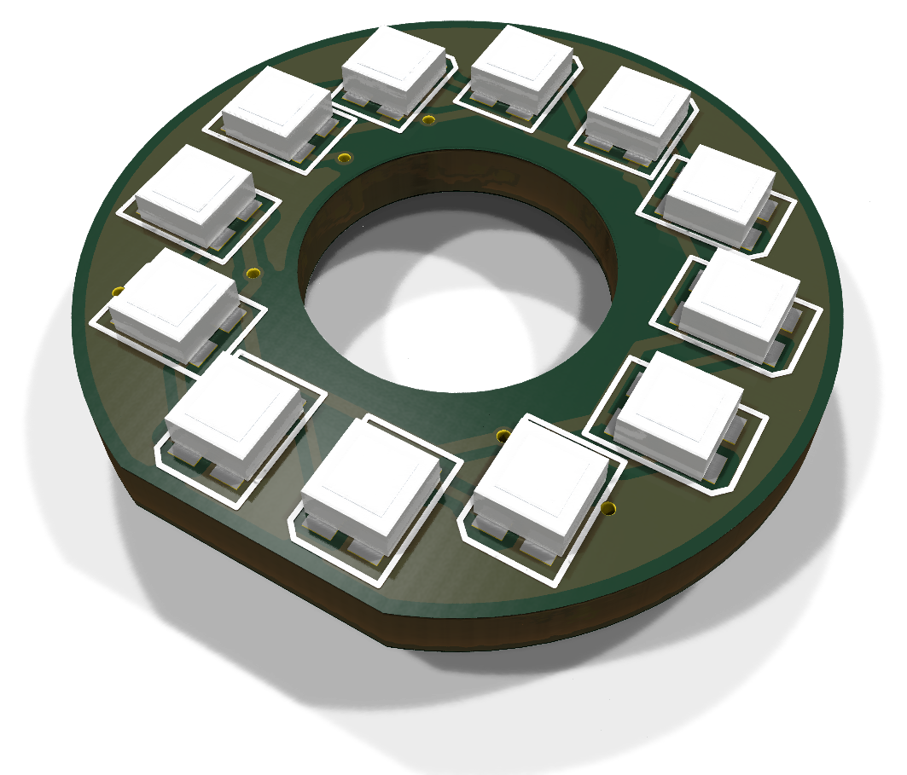
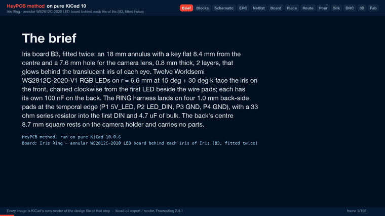
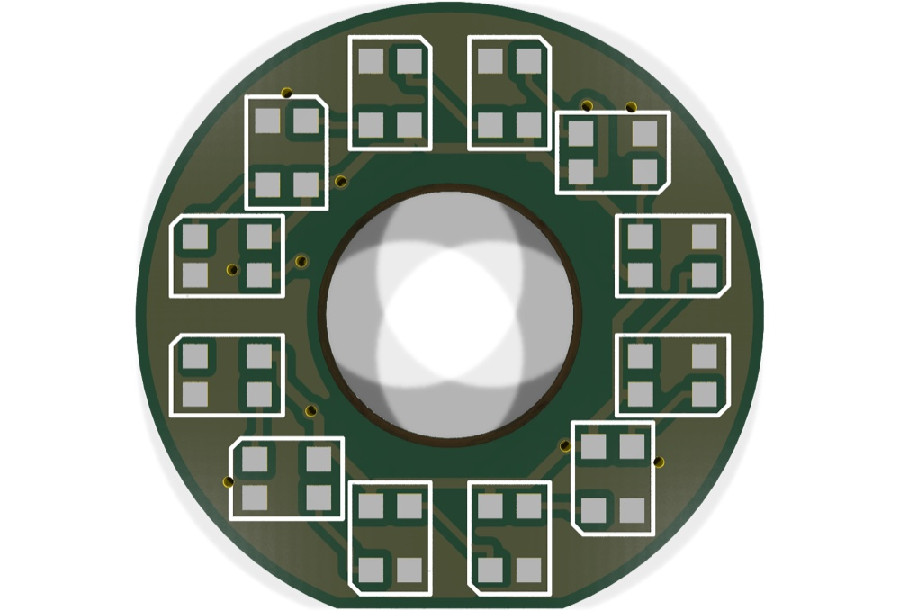
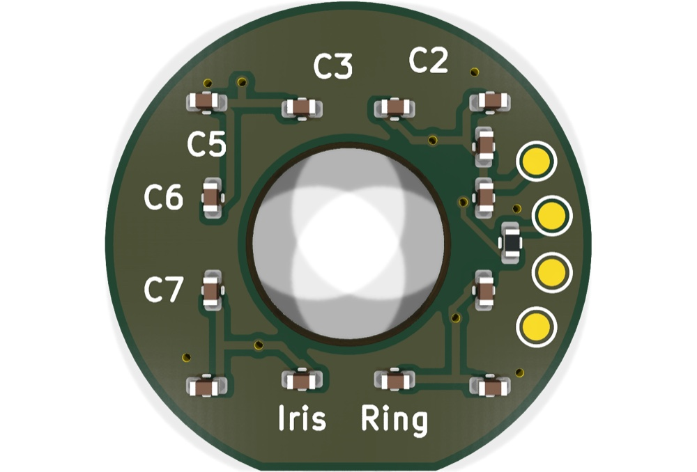
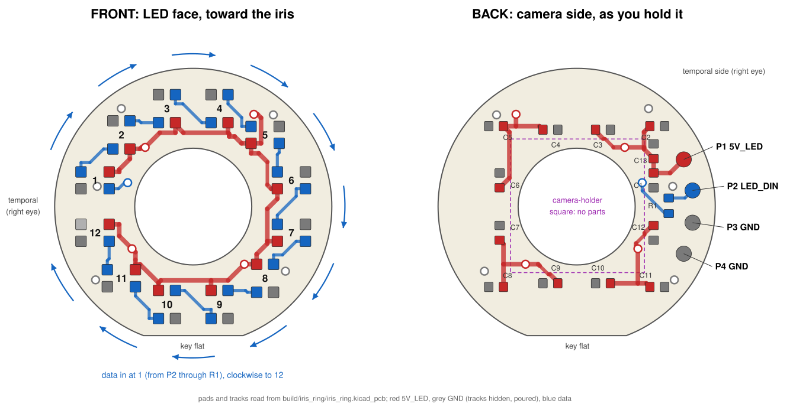

# Iris Ring

The annular LED board behind each iris of Iris: 12 WS2812-2020 pixels on an 18 mm ring around the camera lens, two per head.

Part of [Iris, the human-eyed robot head](https://github.com/HeyPCB/iris), HeyPCB's open robot boards. Designed end to end with the HeyPCB method on
KiCad 10 (headless pipeline, Freerouting 2.4.1); every number below is measured on the files in this repository.
Mentions of `./run.sh`, `docs/rules/`, `blocks/` or `parts/` refer to the heypcb-kicad SDK that produced them.

<p align="center"></p>

| Layers | Outline | Parts | Nets | Connections routed | Vias | ERC errors | DRC errors / unconnected / parity |
|---|---|---|---|---|---|---|---|
| 2 | 18 x 18 mm, shaped with 1 cutout | 30 | 15 | 64 -> 0 open | 10 | 0 | 0 / 0 / 0 |

**Not fabricated, assembled or powered.**

| | |
|---|---|
| KiCad project | [`kicad/`](kicad/) |
| Gerbers (unzipped and zipped), BOM, CPL, STEP, schematic PDF | [`fab/`](fab/) |
| Mechanism CAD, fit check and system docs | [Iris, the human-eyed robot head](https://github.com/HeyPCB/iris) |
| Renders | [top](media/top.png), [bottom](media/bottom.png) |
| Design process, every step as KiCad rendered it | [`media/design-process.mp4`](media/design-process.mp4) |

<p align="center"></p>

Iris Ring is the annular LED board that glows behind each iris of **Iris**, an open-hardware robot
head with human eyes. Each head carries two identical boards, one per eye. Each is an 18 mm disc with
a key flat and a 7.6 mm hole for the camera lens, and it carries twelve WS2812C-2020 RGB LEDs. It was
designed with the HeyPCB method on KiCad 10 (the headless heypcb-kicad pipeline, KiCad 10.0.6,
routed by Freerouting 2.4.1). The brief, `board.json`, is written by `make_brief.py` and follows
section 4.4 (B3) and section 5 (interconnect contracts) of the Iris system spec v0.1 (not
published; the contracts are in [the Iris system docs](https://github.com/HeyPCB/iris/blob/main/docs/system.md)).

**It has not been fabricated, assembled or powered.** Every gate number below comes from the final
run's `report.json` (2026-10-03, `./run.sh --board boards/iris_ring` with media,
from an empty build directory). Copper, pad and position numbers were read from
`kicad/iris_ring.kicad_pcb` with KiCad 10.0.6's pcbnew. Thickness and heights were read
from the solids of `fab/iris_ring.step`. Datasheet facts are cited by page under
*Licence and sources*.

| Front (LED face) | Back (camera side) |
|---|---|
|  |  |



The renders show the LED lands without LED bodies, because KiCad 10.0.6 ships no 3D model for
`LED_WS2812B-2020_PLCC4_2.0x2.0mm`. They also show a 1.6 mm board, not 0.8 mm (see *Check before
ordering*). `draw_map.py` draws the map from the routed board.

## Role in Iris

The ring sits inside each 30 mm eyeball, between the camera and the translucent iris disc. It lights
the iris from behind for gaze and mood cues. B1 Cortex drives it from its RMT peripheral (GPIO47 and
GPIO48, 800 kHz, spec section 8) through a 74AHCT1G125 at 5 V.

**Eye stack-up** along the optical axis, x from the eye centre (spec section 2.2; design values, not
measured on hardware):

| x (mm) | Part |
|---|---|
| 4.36 to 7.01 | OV2640 camera module (right eye) or dummy carrier (left eye); the ring's back rests on the holder top |
| **7.0 to 7.8** | **Iris Ring**: back face 7.0, front face 7.8 (0.8 mm board) |
| 7.8 to 8.64 | WS2812C-2020 bodies, 0.84 mm (catalogue row) |
| 7.01 to 9.01 | camera lens barrel, Ø7.2, through the ring's Ø7.6 hole |
| 9.01 to 9.90 | lens front step, Ø5.4, inside the black pupil sleeve (ID 5.6) |
| 8.65 to 11.1 | light-mixing cavity, painted white inside |
| 11.1 to 11.9 | translucent iris disc, Ø14.6, pupil hole Ø5.6 |
| up to 16.40 | clear cornea dome (apex) |

**Orientation in the head.** The board frame used below has its origin at the ring centre, +x away
from the wire pads and +y toward the key flat, seen from the front.
- **Right eye:** +x is +Y_eye (robot-left, the nasal side), +y is -Z_eye (down). The pads are temporal and the flat is down.
- **Left eye:** the same board turned 180° about the optical axis. +x is -Y_eye, +y is +Z_eye: the pads are again temporal, and the flat is up.

## Features

- **Outline as built** (read from Edge.Cuts):
  - a Ø18.000 mm circle drawn as four true arcs of radius 9.000 mm, plus a key flat: the chord 8.400 mm from the centre, 6.462 mm long, ending at (±3.231, 8.400);
  - a Ø7.600 mm centre hole;
  - bounding box 18.0 x 17.4 mm.

  The polygon's corners are where tangents of the circle meet, so their 9 mm fillets are exact arcs and nothing is faceted.
- **2 layers, 0.8 mm (an order option; see *Check before ordering*).** GND is poured on both faces after routing measured 0 open.
- **12 x Worldsemi WS2812C-2020-V1** (C2976072) on the front on r = 6.600 mm, every 30° from 15°, data chained clockwise.
- **One 100 nF per LED** (12 x 0402, C1525) on the back, plus **4.7 uF bulk** (0402, C23733) and a **33 ohm** DIN series resistor (0402, C25105).
- **Four 1.0 mm wire pads** on the back, at the temporal edge, for the RING harness (P1 5V_LED, P2 LED_DIN, P3 GND, P4 GND).
- **No parts in the back's centre 8.7 x 8.7 mm square**, where the board rests on the camera holder (a footprint keepout on B.Cu, spec 4.4). Tracks and vias may pass under it.
- **Heights.**
  - Front: the LED bodies are 0.84 mm (catalogue row), against the spec's 0.9 mm.
  - Back: the 0402 bodies end 0.585 mm below the back face in the fab STEP (KiCad's stock 0402 models), against the spec's 0.6 mm. Add the solder joints of the wires.
- **No holes.** The carrier's seat and the iris disc's rim clamp the board, and the flat keys its rotation.

## LED chain and data direction

```
P2 LED_DIN -> R1 33 ohm -> D1 -> D2 -> D3 -> ... -> D11 -> D12      (D12 DOUT is not connected)
```

- **Seen from the front, the chain runs clockwise** in both eyes. It starts at D1, the first LED clockwise after the wire pads, and ends at D12, the last LED before them.
  - Right eye: D1 sits on the temporal side, 15° above horizontal.
  - Left eye (board turned 180°): D1 sits on the temporal side, 15° below horizontal.
- **Firmware index k-1 is LED Dk.** A frame is 12 x 24 bits in GRB order, most significant bit first, at 800 kbit/s: 360 µs, then more than 280 µs low to latch (datasheet p.4).
- **Data hops** (front copper, measured): DIN2 to DIN12 repeat 3.04, 1.91 and 3.43 mm four times, one for each quarter of the ring. DIN1 runs from R1 on the back through one via to D1: 2.86 mm on B.Cu and 1.37 mm on F.Cu.

| LED | Angle | Centre (x, y) mm | LED | Angle | Centre (x, y) mm |
|---|---|---|---|---|---|
| D1 | 195° | (-6.375, -1.708) | D7 | 15° | (6.375, 1.708) |
| D2 | 225° | (-4.667, -4.667) | D8 | 45° | (4.667, 4.667) |
| D3 | 255° | (-1.708, -6.375) | D9 | 75° | (1.708, 6.375) |
| D4 | 285° | (1.708, -6.375) | D10 | 105° | (-1.708, 6.375) |
| D5 | 315° | (4.667, -4.667) | D11 | 135° | (-4.667, 4.667) |
| D6 | 345° | (6.375, -1.708) | D12 | 165° | (-6.375, 1.708) |

Angles are measured from +x toward +y, which is clockwise seen from the front. Every centre is at
r = 6.600 mm.

**LED orientation.** Each LED is turned so that DOUT and GND face the rim and DIN and VDD face the
hole, with DOUT on the clockwise side. Data then hops from one LED's outer DOUT to the next LED's
inner DIN, and no hop crosses a supply connection. The SDK places parts in quarter turns only, so
each LED faces the axis nearest its radius. The four diagonal LEDs (D2, D5, D8, D11) take their
clockwise neighbour's turn. That gives 2.56 and 1.86 mm from DOUT pad centre to DIN pad centre; the
other choice gives 4.00 and 3.33 mm.

## Pinout (spec section 5, binding)

RING_R runs from B1 J2 to the right eye's ring, and RING_L from B1 J3 to the left eye's ring.
Each is a JST SH-4 (SM04B-SRSS-TB) at B1, then four 32 AWG silicone wires, 100 mm, soldered to the
pads below.

| B1 pin | B3 pad | Net | Direction | Level |
|---|---|---|---|---|
| 1 | P1 | 5V_LED | B1 -> B3 | 5V_SYS through a 0.5 A PTC or ferrite on B1 (4.85 V nominal at B1's input); the source is B2, via B1 |
| 2 | P2 | LED_DIN | B1 -> B3 | 5 V CMOS from 74AHCT1G125, WS2812 protocol at 800 kHz |
| 3 | P3 | GND | — | |
| 4 | P4 | GND | — | |

Pad centres on the back, measured, in mm from the ring centre (board frame, as seen from the front):

| Pad | Board (x, y) | Right eye (Y, Z) | Left eye (Y, Z) |
|---|---|---|---|
| P1 5V_LED | (-6.952, -3.070) | (-6.952, +3.070) | (+6.952, -3.070) |
| P2 LED_DIN | (-7.527, -1.050) | (-7.527, +1.050) | (+7.527, -1.050) |
| P3 GND | (-7.527, +1.050) | (-7.527, -1.050) | (+7.527, +1.050) |
| P4 GND | (-6.952, +3.070) | (-6.952, -3.070) | (+6.952, +3.070) |

- All four pads are Ø1.0 mm SMD pads on the back face (x_eye = +7.0), on r = 7.6 mm, 2.1 mm centre to centre.
- In the right eye, P1 is the top pad. In the left eye, P1 is the bottom pad.
- The silkscreen carries no pad names (no room at this pitch); the map above has them.

## LED current and power, per ring

From the WS2812C-2020-V1 datasheet: 5 mA per colour channel (p.1, and the LED test condition on
p.3), and 0.5 mA quiescent per LED (p.3). Power is at 4.85 V, H1's nominal 5V_SYS (spec section 5);
the drop in B1's PTC or ferrite and in the harness is not counted.

| State | Current | Power |
|---|---|---|
| Full white: 12 x (3 x 5 mA + 0.5 mA) | 186 mA | 0.90 W |
| Firmware cap, 30 % brightness (spec section 8): 0.3 x 180 mA + 6 mA | 60 mA | 0.29 W |
| All dark: 12 x 0.5 mA | 6 mA | 29 mW |
| One LED at full white | 15.5 mA | 75 mW |

- **Per head** (two rings) at full white: 372 mA, 1.80 W. The spec budgets 180 mA per ring and does not count the quiescent current.
- **Supply copper.** 5V_LED is 67.24 mm of 0.3 mm track and 4.23 mm of 0.225 mm track. The import's width floor kept the narrower stretches where 0.3 mm would not clear another net. By IPC-2221 at a 10 °C rise on 1 oz outer copper (`route.ipc2221_amps`), 0.225 mm carries 0.81 A and 0.3 mm carries 1.00 A: four times the full-white current or more.
- **Supply range:** the datasheet gives VDD +3.7 to +5.3 V (p.3, in its Absolute Maximum Ratings table), and VIH 2.7 V minimum at VDD 5 V (p.3).
- **Decoupling path.** Each LED has its own 100 nF on the back, under its inner pads, but Freerouting did not join each pair through its own via:
  - it tied the twelve VDD pads together with a front ring, and the capacitors with a back ring;
  - it joined the two rings with 4 vias;
  - the copper path from each LED's VDD pad to its own capacitor is 4.51 to 13.88 mm long (D8 and D6), measured on the board's track graph.

## Measured gates

| Gate | Result |
|---|---|
| Composition | 13 block instances (12 `irisring_pixel`, 1 `irisring_wire_in`) -> 30 parts, 15 nets, 1 no-connect (D12 DOUT) |
| Part binding (`parts/lcsc_pinned.json`) | 26 of 26 BOM parts bound, 0 unsourced, 0 identity conflicts; the four wire pads are do-not-populate (nothing to buy). 1 distinct Extended part (the LED), about $3 in JLC loading fees |
| ERC (`kicad-cli sch erc --severity-all`) | 0 errors, 0 warnings |
| Netlist round trip | identical, 15 nets |
| Freerouting, rung 1, fanout on (kept) | 64 -> 1 open; the last mile closed it (GND, D10.2 to C1.2, 3.16 mm, no via; kept by DRC): **0 open**, DRC score 0 |
| Freerouting, rung 1, fanout off (measured for comparison) | 64 -> 1 open (DIN11, D10.1 to D11.3); the last mile found no path. DRC score 1 |
| Copper | 225 tracks, 10 vias (5 GND, 4 5V_LED, 1 DIN1), 191.4 mm of track (F.Cu 105.4, B.Cu 86.0). No class was narrowed |
| Pours (only after a measured 0 open) | GND on F.Cu and B.Cu; 0 stitching vias (no point of the 3 mm lattice fitted); 0 open after the pour and at the end; no island-repair vias |
| Silkscreen | the name, "Iris" and "Ring", placed as 2 words on the back; 5 back designators seated (C2, C3, C5, C6, C7), 23 hidden where nothing fit; nothing clipped |
| DRC (`--severity-all --schematic-parity`, KiCad 10.0.6) | fresh, **0 errors, 0 warnings, 0 unconnected, 0 parity** |
| DFM (`jlcpcb_2layer`) | 0 errors, 1 warning (92 stock-footprint silk strokes at 0.12 mm; the fab prints them at its 0.15 mm minimum) |
| Fab gate | **ready**, no blockers; gerbers for 2 copper layers, drill, BOM, JLC CPL (8 rotations corrected), schematic PDF, STEP |
| Media | renders and the design-process video (108.5 s, 158 frames), in `build/iris_ring/` (not committed) |

## Decisions and departures from the spec

| The spec says | On the board | Why |
|---|---|---|
| LEDs on r = 6.6 at 15° + 30°·k | Exactly that, every lock computed from its angle (`make_brief.py`) | Each centre is at r = 6.600 mm (measured) |
| (implied) LEDs turned radially | **Quarter turns**: each LED faces the axis nearest its radius | The SDK places parts at 0, 90, 180 or 270° only. A lock at 225° stops the place stage with an unnamed `ValueError: 225` from `place._rot_pt`. The positions keep 4-fold symmetry, and so do the data hops |
| P1-P4: `Connector_Generic:Conn_01x04` on 4 x `TestPoint_Pad_D1.0mm`, r = 7.35, 1.27 mm pitch | 4 x `Connector:TestPoint` on `TestPoint_Pad_D1.0mm`, on **r = 7.6, 2.1 mm apart** | A 4-pin symbol cannot sit on four 1-pad footprints. The stock footprint's courtyard is a Ø2.0 mm circle, so 1.27 mm pitch is a `courtyards_overlap` DRC error. The pads keep their Ø1.0 mm and the §5 order |
| C1-C12 on the back at r ≥ 6.3 | **8 at r = 5.28** (C1, C3, C4, C6, C7, C9, C10, C12), lying along the ring under their LED's inner pads; **4 at r = 7.40** on the diagonals (C2, C5, C8, C11) | The inner positions leave the back's band above the key flat free for the board's name, and put each capacitor's 5V_LED pad beside its LED's VDD pad. Every part clears the camera-holder square: `make_brief.py` checks it, and the keepout's DRC confirms it. On the diagonals the square's corner reaches r = 6.15, so those four stay outside it |
| Copper to edge: not in the spec (the other boards here use 0.5 mm) | **0.3 mm** | D9 and D10 come to 0.76 mm from the key flat. At 0.5 mm no ground track fitted below them, the router ran GND between the LEDs, and DIN11 stayed open (measured on this brief). At 0.3 mm it routes to 0 open |
| Board name on the back "if it fits" | **"Iris Ring"** as two silk words below C9 and C10, in a via-free window | As a title line it found no room: the silk stage seats designators first, and they took the only free band. Words are placed before designators |

## Assembly notes

- **Two per head, one per eye.** The boards are identical; build four for two heads plus spares.
- **Orientation by the key flat.**
  - The carrier's seat (Ø18.2 x 0.8 with a flat, spec section 7.1, part P4) turns the board.
  - Right eye: flat down, wire pads temporal.
  - Left eye: flat up, wire pads temporal.
  - The LEDs face the iris. The back, with the capacitors and pads, faces the camera.
- **The camera lens passes through the right eye's ring.**
  - The OV2640's Ø7.2 mm lens barrel runs through the Ø7.6 mm hole (spec section 2.2), about 0.2 mm radial clearance by the spec's numbers.
  - The board's back rests on the 8.5 x 8.5 mm holder top, which is why the centre 8.7 mm square of the back carries no parts.
  - The black pupil sleeve (ID 5.6) runs over the lens step inside the hole, so no LED light reaches the lens.
  - The left eye has the dummy carrier with the same envelope and a black pupil plug.
- **Wires.**
  - Solder the four 32 AWG wires to P1-P4 on the back, in the map's order: P1 5V_LED nearest the top in the right eye.
  - Keep each joint inside the back's 0.6 mm height budget, and lead the wires into the carrier's wire channel.
  - B1's J2 and J3 are interchangeable by design; firmware has a swap flag (spec section 5).
- **Clamp.**
  - The LED bodies reach r = 8.09 mm on the diagonals and 7.95 mm elsewhere (KiCad's 2.2 x 2.0 mm F.Fab outline).
  - The iris disc's clamping rim must land on the front between r = 8.1 and the 9.0 mm edge, or on the flat.
- **LED handling** (datasheet):
  - Moisture level 5a: 24 h out of the bag at under 30 °C and 60 % RH, else bake at 75 °C for more than 24 h (p.7-8).
  - Reflow peak 245 °C (p.8).
  - The parts are on both faces: 12 LEDs on the top, 14 parts on the bottom (CPL).
- **First test.** Light D1 to D12 in turn: D1 must be the first LED clockwise after the pads, seen from the front.

## Check before ordering

- **Order 0.8 mm thickness.**
  - The pipeline has no thickness setting. Its gerber job states `BoardThickness` 1.6 mm (KiCad's default 2-layer stackup: 0.035 mm copper, 1.51 mm FR4).
  - The fab STEP's board body is 1.510 mm thick (z 0 to 1.510, measured on the solid), and the renders show the same.
  - Choose 0.8 mm in the fab's order form. The eye stack-up above assumes 0.8 mm: at 1.6 mm the LEDs would stand 0.8 mm further into the light-mixing cavity.
  - The mechanism's fit check against this board's STEP confirms it ([`cad/out/fit.json`](https://github.com/HeyPCB/iris/blob/main/cad/out/fit.json), board B3): at 0.8 mm the ring seats in the eye carrier under the iris clamp ring with no collision; at the exported 1.51 mm the board overlaps the clamp ring by 21.3 mm³, so the clamp would sit 0.71 mm high.
- **0.3 mm copper to edge.** Confirm it against the fab's routed-edge rule; the other boards in this repository use 0.5 mm.
- **Mechanism CAD.**
  - Use the outline and pad positions above, and the wire-pad pitch of 2.1 mm, not the spec's 1.27 mm.
  - The fab STEP has **no LED bodies** (no KiCad model). Add 2.2 x 2.0 x 0.84 mm envelopes (the catalogue row; KiCad's F.Fab outline is 2.2 x 2.0) at the LED centres in the table, turned as on the map.
  - Back-side capacitors sit at r = 5.28 and 7.40 mm. They need the carrier's 0.6 mm relief there, outside the holder's square.
- **The 4.7 uF's height.** The STEP uses KiCad's generic 0402 model (0.5 mm body). Confirm CL05A475MP5NRNC's thickness on its datasheet: the back's budget is 0.6 mm.
- **Bulk capacitance at 5 V.** CL05A475MP5NRNC is a 10 V X5R part. Its capacitance at 5 V bias is below 4.7 uF (not measured here).
- **LED rotation in the assembler's preview.** The pipeline's JLC CPL corrected 8 rotations. Check that each LED's pin-1 chamfer matches the silkscreen: a part turned 180° swaps VDD with GND.
- **Stock.** Live lookups of 2026-10-03: C2976072 376,897 (Extended); C25105 968,914; C23733 964,426. C1525 had 16,407,331 at its 2026-09-30 snapshot. Re-check on the day.
- **Decoupling path.** If a scope shows supply noise at an LED, the 13.88 mm path from D6 to its C6 is the longest (see *LED current and power*).
- **Silkscreen.** Five back designators printed and the rest did not; the wire-pad names are only on the map.

## Files

- `board.json`: the brief, written by `make_brief.py`. Edit the script, not the JSON. The script places every part by formula and checks courtyards, the camera-holder square and the edge clearances before the pipeline runs.
- `make_brief.py`: the outline, every lock and the brief (Python 3.9+, standard library only).
- `draw_map.py`: the assembly map, `img/iris_ring_map.svg`, drawn from the routed board (run it under KiCad's Python).
- `img/`: KiCad's raytraced renders of both faces and an angled view (`iris_ring_3d.jpg`), and the map.
- Blocks: `blocks/irisring_pixel.json` (one LED and its 100 nF) and `blocks/irisring_wire_in.json` (wire pads, 33 ohm, 4.7 uF).
- Part rows: C2976072, C25105 and C23733 in `parts/lcsc_pinned.json`, from live lookups of 2026-10-03.
- Regenerate everything with `python3 boards/iris_ring/make_brief.py`, then `./run.sh --board boards/iris_ring`. The outputs land in `build/iris_ring/`, which is not committed: gerbers, drill, BOM, CPL, schematic PDF and STEP in `fab/`, and the renders and video.

## Licence and sources

The Iris Ring design files are licensed under the **CERN Open Hardware Licence Version 2 -
Strongly Reciprocal (CERN-OHL-S-2.0)**, https://ohwr.org/cern_ohl_s_v2.txt. They are this
directory, `blocks/irisring_pixel.json` and `blocks/irisring_wire_in.json`. KiCad's symbols,
footprints and 3D models are CC-BY-SA-4.0 with the KiCad library exception. No datasheet is copied
into this repository.

- Worldsemi WS2812C-2020-V1 datasheet (V1.0, 2021-06-24), via LCSC, https://www.lcsc.com/datasheet/C2976072.pdf:
  - p.1: 5 mA per colour channel; 800 kbit/s;
  - p.2: pins 1 DO, 2 GND, 3 DI, 4 VDD, which matches KiCad's `LED:WS2812B-2020` symbol (1 DOUT, 2 VSS, 3 DIN, 4 VDD);
  - p.3: VDD +3.7 to +5.3 V, VIH 2.7 V min, VIL 0.7 V max, quiescent current 0.5 mA, luminous intensity at 5 mA (R 100-150, G 250-400, B 45-75 mcd);
  - p.4: GRB bit order and reset time above 280 µs;
  - p.5: 100 nF across VDD per LED;
  - p.7-8: moisture level 5a and the 245 °C reflow peak.
- LCSC C2976072 product page, https://www.lcsc.com/product-detail/C2976072.html: 0.84 mm body height (the catalogue row read on 2026-10-03).
- Iris system spec v0.1 (not published), sections 2.2, 4.4, 4.5, 5, 6 and 8; its binding contracts are in [the Iris system docs](https://github.com/HeyPCB/iris/blob/main/docs/system.md).
